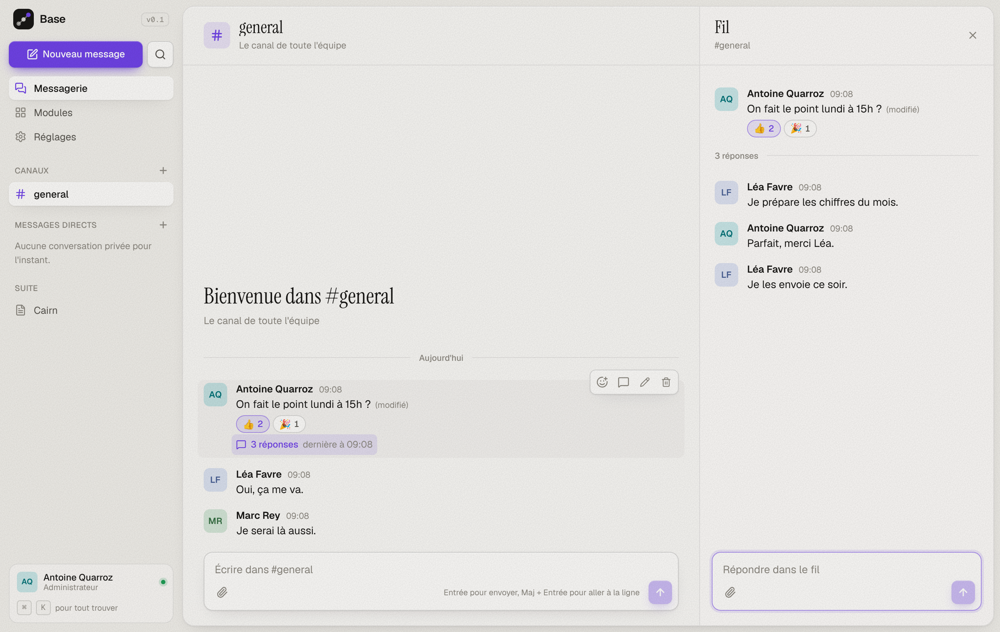
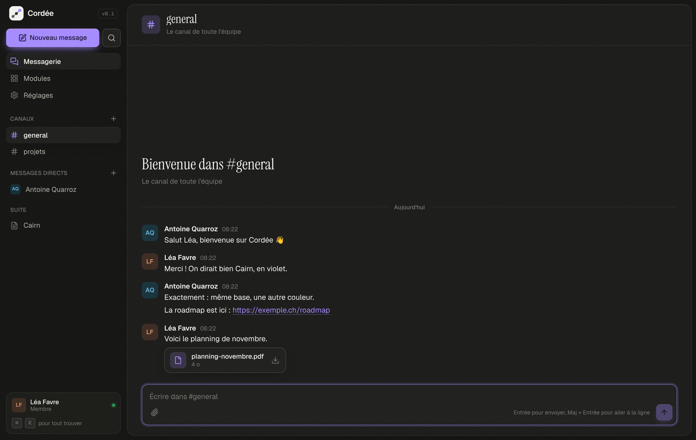

# Lamio

La messagerie de l'équipe, et la base de la suite. Canaux, messages directs, fichiers : c'est ici qu'on se parle, et c'est ici que les autres outils viennent se brancher.

Lamio fait partie de la même suite que [Cairn](https://github.com/antoinequarroz/Cairn) (notes et coffre), [Metricove](https://github.com/antoinequarroz/metricove_v2) (réseaux sociaux) et [Alfred](https://github.com/antoinequarroz/Alfred) (calendrier) : même stack, même design, une autre couleur. Ici, le violet.




## Ce qui marche aujourd'hui

- **Comptes** : la première personne qui ouvre l'app crée son compte et devient administratrice. Elle ajoute ensuite les membres dans Réglages.
- **Canaux** : ouverts à toute l'équipe, créés en deux clics. `#general` existe dès le départ.
- **Canaux privés** : visibles seulement de leurs membres. Un membre peut en ajouter d'autres, chacun peut quitter.
- **Réglages du canal** : la personne qui l'a créé (ou une administratrice) le renomme, change son sujet et retire un membre.
- **Messages directs** : à une personne, ou à soi-même pour garder une note.
- **Fils de réponses** : on répond à un message dans un panneau à côté, sans encombrer le canal.
- **Réactions** : un emoji sur un message, en un clic.
- **Modifier ou supprimer** ses messages. Un message modifié le signale.
- **Fichiers** : par le trombone, en glisser-déposer ou en collant. Les images s'affichent dans la conversation.
- **Mentions** : `@` propose les personnes de la conversation, `@tous` prévient tout le monde. Une mention se voit dans le message et dans la barre latérale.
- **Notifications** : un message direct ou une mention s'annonce dans l'app, et sur l'appareil si on l'active dans Réglages.
- **En direct** : les messages arrivent sans recharger la page, avec les compteurs de non lus.
- **Recherche ⌘K** : aller à un canal, une personne, une action, ou retrouver un message et y sauter.
- **Webhooks entrants** : dans les réglages d'un canal, sa créatrice (ou une administratrice) crée une adresse secrète par laquelle une autre application y écrit, par exemple les alertes d'Orbi. `POST <adresse>` avec `{"text": "…"}` (ou `title`, `body`, `url`) ; 30 messages par minute au plus. L'adresse ne s'affiche qu'une fois ; la supprimer la coupe aussitôt.
- **Modules** : la liste des outils de la suite, et ceux qui sont branchés.
- **Une seule connexion** : Cairn et Metricove s'ouvrent avec le compte Lamio, sans autre mot de passe. Les administrateurs y entrent toujours, et choisissent module par module quels membres y ont accès.
- **Clair et sombre** : comme l'appareil, ou forcé dans Réglages.
- **Installable** comme une app sur Mac (Safari, « Ajouter au Dock ») et sur iPhone (« Sur l'écran d'accueil »).
- **App Mac** : une vraie app dans le Dock, à construire depuis [`desktop/`](desktop/README.md).

## Lancer en local

```bash
pnpm install
pnpm dev
```

Puis ouvrir http://localhost:3000 et créer le premier compte.

```bash
pnpm test    # comptes, conversations, messages, fichiers, modules
pnpm lint
pnpm build
```

## Configuration

Copier `.env.example` en `.env.local` (en local) ou `.env` (sur le VPS). Rien n'est obligatoire.

| Variable | Rôle |
| --- | --- |
| `DATA_DIR` | Dossier de la base SQLite et des fichiers (`./data` par défaut). |
| `MAX_FILE_MB` | Taille maximale d'un fichier joint (25 Mo par défaut). |
| `CAIRN_URL`, `METRICOVE_URL`, `ALFRED_URL`, `NINO_URL`, `TICKUP_URL` | Adresse d'un outil de la suite, pour le brancher. |
| `ALFRED_API_TOKEN` | Jeton créé dans Alfred (Réglages › Accès à l'agenda) : ouvre l'onglet **Calendrier**. `alfw_…` (lecture et écriture) pour créer et modifier les événements depuis Lamio, `alf_…` pour seulement les voir. `ALFRED_API_URL` (facultatif) : où le serveur joint Alfred. |
| `APP_URL` | Adresse publique de Lamio. Sert aussi à écrire l'adresse des webhooks entrants (sinon, celle par laquelle la page est ouverte). |
| `COMPTE_URL`, `COMPTE_CLIENT_SECRET`, `APP_URL` | Branche Lamio sur le Compte Postmelo (compte unique de la suite). Voir [docs/DEPLOIEMENT.md](docs/DEPLOIEMENT.md). |
| `CAIRN_SSO_SECRET`, `METRICOVE_SSO_SECRET`, … | Secret partagé avec l'outil (32 caractères au moins), pour y entrer avec son compte Lamio. |

## Les modules

Tout est dans [`src/modules/registry.ts`](src/modules/registry.ts) : une entrée par outil. Trois états, comme dans la feuille de route :

1. **Actif** : fait partie de cette app (la messagerie).
2. **Branché** : l'outil tourne à son adresse, elle l'ouvre. Il suffit de donner son adresse dans `.env`.
3. **Bientôt** : prévu, pas encore branché.

L'étape suivante (des échanges de données entre les outils) partira de ce fichier.

### Une seule connexion

Un outil branché peut faire confiance à Lamio pour savoir qui arrive. Il faut un secret partagé : `CAIRN_SSO_SECRET` ici, `LAMIO_SSO_SECRET` et `LAMIO_URL` dans l'outil. L'outil affiche alors « Se connecter avec Lamio ».

1. L'outil envoie le navigateur vers `/sso/authorize?client=cairn&state=<aléatoire>`.
2. Si la personne est connectée à Lamio et a le droit d'ouvrir cet outil, Lamio la renvoie vers `<adresse de l'outil>/api/auth/lamio?code=…&state=…`. Le code ne sert qu'une fois et vit une minute. L'adresse de retour est toujours celle du `.env`, jamais un paramètre.
3. Le serveur de l'outil échange le code contre la personne : `POST /api/sso/token` avec `{ "client": "cairn", "code": "…" }` et le secret en `Authorization: Bearer`. Réponse : `{ "user": { "id", "name", "email", "role" } }`.

Le détail est dans [`src/server/sso.ts`](src/server/sso.ts). Pour brancher un nouvel outil, le plus simple est de copier `src/server/lamio.ts` et `src/app/api/auth/lamio` depuis Cairn.

## Comment c'est fait

Next.js 15, React 19, Tailwind 4, SQLite (better-sqlite3). Un seul processus, une seule base : simple à héberger tant que l'usage est personnel.

| Dossier | Contenu |
| --- | --- |
| `src/server/db.ts` | Toute la base : comptes, sessions, conversations, messages, fichiers. Le seul endroit à réécrire pour passer à PostgreSQL. |
| `src/server/auth.ts`, `password.ts` | Sessions (cookie, jeton aléatoire dont seule l'empreinte est gardée) et mots de passe (scrypt). |
| `src/server/events.ts` | Les messages en direct, en mémoire. À remplacer par Postgres ou Redis le jour où il y a plusieurs serveurs. |
| `src/app/api` | L'API. Chaque route vérifie la session, et le droit de lire la conversation. |
| `src/lib/store.tsx` | L'état côté navigateur : moi, l'équipe, mes conversations, le flux en direct. |
| `src/lib/brand.ts` | Le nom de l'app, à un seul endroit. |
| `src/components` | L'interface. `ui.tsx` contient les briques communes à la suite. |
| `src/app/globals.css` | Les couleurs et le thème, repris de Cairn et Metricove. |

## La suite

- Archiver ou supprimer un canal.
- Notifications quand l'app est fermée.
- App iOS, et notifications de l'appareil dans l'app Mac.

## Déploiement

Le guide pas à pas est dans [docs/DEPLOIEMENT.md](docs/DEPLOIEMENT.md) : mise en ligne sur le VPS derrière le Caddy déjà en place, connexion unique avec Cairn et Metricove, sauvegardes. Les données vivent dans le volume `app-data` (base et fichiers).
